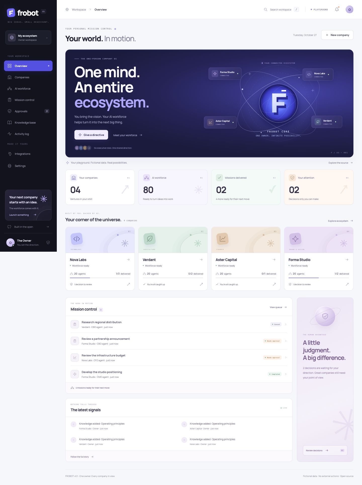

# FROBOT

**An owner-controlled operating system for one-person companies.**

Direct a company’s work, delegate through an executive–manager–specialist hierarchy, review sensitive proposals, and inspect every handoff from one workspace.

[Try the public sandbox](https://frobot-company-os.mintybook4.chatgpt.site) · [Architecture](docs/ARCHITECTURE.md) · [Deployment](docs/DEPLOYMENT.md) · [Roadmap](docs/ROADMAP.md)



FROBOT v0.1 is a working foundation, not a production autonomous company. It runs without a paid service or third-party runtime dependencies. The optional Anthropic adapter generates drafts; no adapter can send messages, spend money, file taxes, sign documents, execute code, or control physical devices.

## Start in under a minute

Install **Node.js 22.13 or later** (Node 24 LTS recommended), then:

```sh
git clone https://github.com/naazzarov/frobot.git
cd frobot
npm start
```

Open **http://127.0.0.1:3000**. No `npm install` is needed. Node 22 may print an experimental SQLite warning; the application uses the built-in `node:sqlite` module.

The initial workspace contains four fictional companies. Create your own company, give a directive, and open a queued mission to run it. Without an AI key, the result is an explicitly labeled planning template.

## What works today

- Multi-company dashboard with company-scoped tasks, knowledge, agents, and decisions.
- Six executive roles: CEO, CTO, CFO, CMO, CBO, and CSO.
- Fourteen manager roles provisioned automatically for each company.
- Task-scoped specialist creation and archival with structured delegation messages.
- Durable task states: queued, running, awaiting approval, completed, failed, and rejected.
- Owner approval notes and replay protection for sensitive proposals.
- Global, company, executive, and manager pause controls. Interrupted results are discarded.
- Knowledge context supplied only from the mission’s company.
- SQLite persistence, restart recovery, transactional state changes, and a SHA-256 audit chain.
- Optional server-side Anthropic draft generation through a replaceable provider interface.
- Responsive dashboard, keyboard search (`/`), new directive shortcut (`N`), and downloadable Markdown results.
- Workspace and audit exports, input validation, same-origin checks, and optional Owner token authentication.

Company isolation here means application-level scoping within one trusted Owner workspace. It does **not** mean independent database tenants or a multi-user security boundary.

## Two ways to explore

**Public sandbox:** static hosting, fictional data, per-browser local storage, deterministic planning templates. No backend, API credentials, shared company database, or real integrations. Use Settings → Reset demo for a fresh workspace. Do not put private business data into the public demo.

**Local backend:** the same interface and domain engine, with SQLite persistence and an optional AI provider. The default binds to loopback only. Setting `FROBOT_OWNER_TOKEN` enables authentication even locally.

## Enable AI-generated drafts

```sh
cp .env.example .env
```

Edit `.env` locally:

```dotenv
ANTHROPIC_API_KEY=your-own-key
ANTHROPIC_MODEL=claude-sonnet-4-6
```

Restart `npm start`. The dashboard will show **AI drafts enabled**. Running a mission sends its brief, company name/mission, and a bounded subset of that company’s knowledge to Anthropic. Consider that disclosure before adding operational data. Keys are read on the server and are never included in the UI, exports, prompts, or audit events. Model availability depends on your provider account; override the model when needed.

The provider uses the [Anthropic Messages API](https://platform.claude.com/docs/en/api/messages/create). No live provider call was made during the initial build because no API key was supplied; provider lifecycle and failure behavior are covered with injected providers in tests.

## Validate

```sh
npm run check
npm test
```

The test suite covers company context isolation, sensitive-proposal gating, approval replay, duplicate runs, in-flight interruption, persistence, crash recovery, API authentication, origin checks, and audit integrity.

CI runs on Node 22 and 24. The repository includes a dependency-free Docker image definition and deployment instructions. The Docker path is provided for reproducibility and must be verified in your target environment.

## Repository layout

```text
public/             Dashboard and shared domain engine; also the static sandbox
  core.js           Company, agent, mission, approval, and pause state machine
  app.js            Dashboard views, browser API client, sandbox persistence
src/
  server.js         HTTP API, authentication, same-origin checks, run lifecycle
  store.js          SQLite snapshots and append-only hash-chained events
  providers.js      Template provider and Anthropic draft adapter
test/               Domain and HTTP integration tests
docs/               Architecture, API, operations, integrations, roadmap
.github/workflows/  CI
```

## Deliberate limits

Executive and manager delegation is currently deterministic. One model call generates a mission’s specialist draft; this is not six independently reasoning executives or a recursive agent runtime. Missions run on Owner request; there is no autonomous background scheduler yet. The queue survives restart, but distributed leases, automatic retries, billing quotas, and horizontal workers are future work.

External accounting, banking, CRM, communications, cloud documents, HR, tax systems, vector search, voice, and embodied AI are extension points documented in the [roadmap](docs/ROADMAP.md). Their cards accurately display **Not connected**. “Completed” means a draft artifact was produced.

Audit history is tamper-evident against accidental/local row changes, not immutable against a host administrator. The single-workspace SQLite snapshot architecture is suited to a pilot, not a multi-tenant production SaaS. See [security](SECURITY.md) before operating beyond a local demonstration.

## Public repository hygiene

Only source, fictional seed data, placeholder configuration, and project documentation belong here. `.env`, local databases, runtime state, logs, and dependencies are ignored. The original internal project brief and its personal/company details are intentionally excluded. Code is public; real business records should remain in your own private runtime storage.

## Contributing

See [CONTRIBUTING.md](CONTRIBUTING.md). Keep work small, test the safety boundary you change, and never include credentials or real customer data in issues or pull requests.

## License

[MIT](LICENSE).

The interface bundles Manrope by the Manrope Project Authors, licensed under the [SIL Open Font License](docs/fonts/Manrope-OFL.txt). The font is served locally; no third-party font request is needed.
