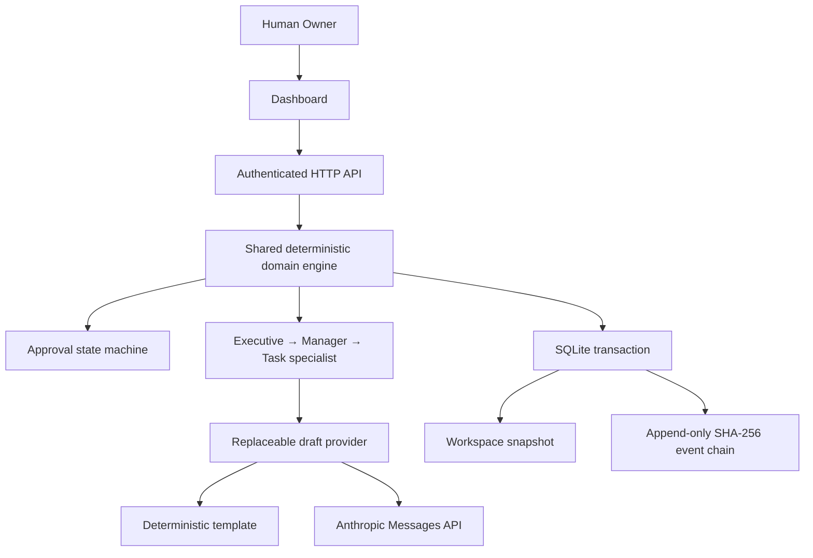
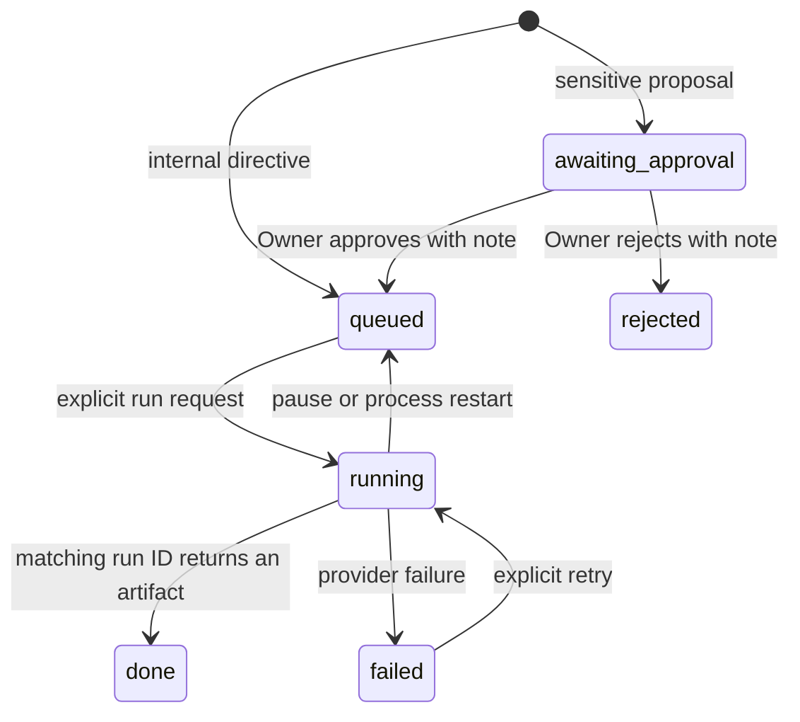

# Architecture

## Runtime

The public static sandbox uses the exact same domain engine. It replaces HTTP persistence with browser-local storage and always uses the template provider. It has no server-side company database or live AI configuration.

## Organization

The Owner is a human root principal, never an AI agent. Each company gets 6 executives and 14 managers. Managers reference their executive by ID. A mission creates a temporary staff specialist under the department’s first manager, and archives it after completion, failure, or interruption. Specialized manager routing is a future enhancement; the initial run path deliberately uses the first department manager.

Executives and managers are role templates and deterministic delegation steps in v0.1. The model generates one bounded specialist draft. There is no claim of independent autonomous executive reasoning.

## Task lifecycle

Every mutation is synchronous until the persistence transaction commits. A provider request starts only after the running state is durable. Duplicate run requests see `running` and fail. Each attempt receives a new run ID. Pause clears that ID before trying to abort the provider. A late response cannot commit against an invalidated ID. Startup requeues interrupted work; it does not automatically rerun or create a second paid request.

Idempotency keys prevent repeated mission creation within a company. Provider requests are not automatically retried, which avoids hidden repeated charges. An Owner can retry failed work explicitly.

## Decisions and tools

Task action type, amount, and conservative text checks can require Owner review. Approval releases draft preparation only. No real tools are registered. Future tools must bind approval to the exact action payload and reject any changed payload; keyword detection cannot authorize a bank transfer or outgoing message.

Every message carries sender, recipient, intent, payload, priority, deadline, company ID, task ID, and time. Every task and knowledge lookup for execution is scoped by company. This is a single-Owner workspace with shared storage, not hard database tenant isolation or per-agent authentication.

## Persistence and audit

SQLite uses WAL mode and `synchronous=FULL`. One transaction saves the current workspace JSON snapshot and appends new audit records. Existing audit event prefixes cannot change through the store API. SQL triggers reject audit update/delete operations.

For each sequential record, `hash = SHA256(seq + newline + previous_hash + newline + event_json)`. Startup verifies the chain and the snapshot’s event list. Hashes provide local tamper evidence; a privileged host administrator can replace the chain. Use independent signed checkpoints for stronger integrity guarantees.

The snapshot makes a local pilot straightforward, but copies and serializes the full workspace per mutation. It is not an appropriate design for a high-volume multi-tenant system. A later release should normalize transactional data, lease jobs, partition tenant records, move artifact bodies to object storage, and add a worker runtime.

## Technology choices

The UI uses native browser modules, accessible HTML, and CSS. The server uses built-in Node HTTP, crypto, filesystem, fetch, and SQLite APIs. There are no npm runtime dependencies or external font/image requests. The [Node SQLite documentation](https://nodejs.org/api/sqlite.html) describes the database API. The optional model gateway uses the [Anthropic Messages API](https://platform.claude.com/docs/en/api/messages/create).

This initial vertical slice favors a small auditable core. Kubernetes, per-role microservices, vector databases, long-running workflow engines, and object storage are deferred until the pilot demonstrates a need for them.
