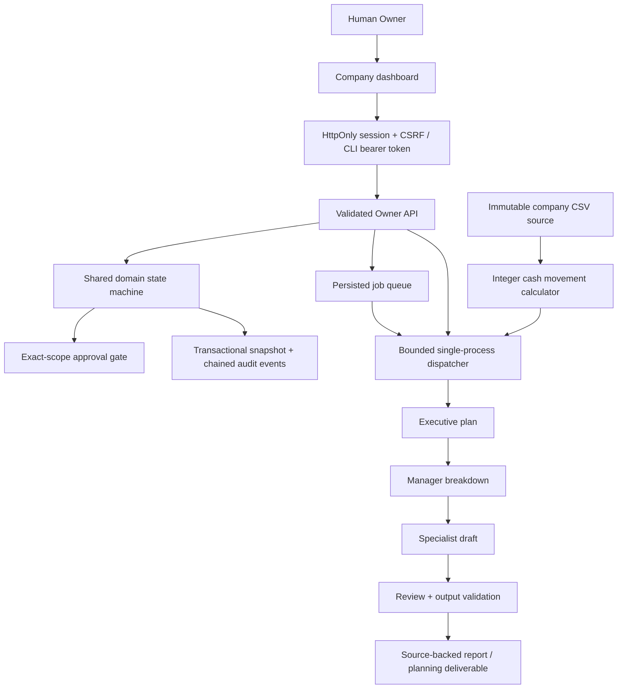

# FROBOT v0.2 architecture

## One shared domain, two runtimes

The static sandbox and Node backend import `public/core.js`, `finance.js`, and `workflow.js`. The sandbox uses browser storage and deterministic stages. The backend adds SQLite, authentication, a provider gateway, durable jobs, and Operations. Neither runtime registers an external side-effect tool.

## Organization and execution

Every company has six executive and fourteen manager records. A mission creates a temporary staff specialist under a manager. Ledger missions route through the CFO’s Accounting Manager; other missions currently use the first department manager. Staff records archive after completion, failure, cancellation, or interruption.

The workflow has four explicit contracts:

- Executive: objective, acceptance criteria, risks.
- Manager: bounded steps and definition of done.
- Specialist: a Markdown artifact and exact evidence IDs.
- Reviewer: pass/fail, issues, and an advisory summary.

With Anthropic configured, each stage is a separate bounded request. Without a provider key, all stages are deterministic. This is a sequential, bounded role workflow, not independent autonomous executive services. The provider receives a cloned, company-scoped context; it cannot modify trusted calculation inputs. Prior stage outputs are passed as untrusted data. No model output becomes an API action.

Malformed contracts, unknown evidence, numeric claims in finance commentary, and reviewer rejection prevent a final artifact. Finance commentary is qualitative; totals come from the calculator. These checks reduce error surfaces but do not certify semantic truth or eliminate prompt-injection risk. Model review remains advisory.

## Source-backed finance

CSV sources contain one supported currency, ISO dates, descriptions, signed decimal amounts, and optional categories. Imports validate quotas and fields; source records are immutable. Duplicate sources are rejected within a company. Possible duplicate transactions remain included in totals and are flagged.

Amounts convert to exact integer minor units. Inflows, outflows, net movement, months, and expense categories are calculated from every row. Reports include source IDs and bounded row evidence; JSON exports preserve the full source. Cash movement is not profit, an opening/closing bank balance, a reconciliation, or tax advice. No currency conversion occurs.

## State and approvals

Tasks are queued, awaiting approval, running, done, failed, rejected, or cancelled. Approval notes bind to an exact serialized company/task payload. A changed payload cannot reuse an earlier decision. Approval releases deliverable preparation only; it never authorizes an external transaction.

Each run has a fresh run ID. Pausing or cancelling clears it before attempting provider cancellation. Late outputs and checkpoints fail the ID check. Explicit retries use a new run ID and preserve prior audit events; the visible trace represents the current/latest attempt. Startup requeues interrupted task state and marks interrupted jobs failed for inspection, without automatically repeating paid requests.

## Queue and resource controls

Jobs live in a normalized SQLite table with an active-job uniqueness index. Due jobs are atomically claimed with a lease token; heartbeats extend active leases. One dispatcher bounds concurrent provider runs. Schedules survive process restart. Pending approved work runs while the server is online; interrupted active jobs require inspection and explicit retry.

Run only one server process per workspace database. Startup recovery assumes that single-process deployment. Lease fields support local lifecycle control; they do not make the snapshot architecture safe for distributed workers. Queue insertion and domain audit persistence are separate operations; deployments requiring strict cross-record atomicity need a normalized workflow store.

The runner persists a reservation before every Anthropic stage request. Global and per-company UTC-day limits include uncertain/failed requests. Completed responses record reported token usage. Caps count requests, not provider billing dollars. There is no hidden automatic retry loop.

## Authentication and observability

Browser login exchanges an Owner credential for an eight-hour HttpOnly, SameSite=Strict session. Only its digest is kept server-side; the CSRF secret is held in memory in the browser. Mutations require CSRF. Sessions expire and restart invalidates them. CLI clients may use the configured bearer token. Login and API mutation attempts are rate-limited. TLS is required across a network; enable Secure cookies behind HTTPS.

Operations shows actual task counts, jobs, completed stage counts, daily reservations, reported tokens, uncertain requests, and audit verification. It is not a revenue, savings, model-quality, or uptime dashboard.

## Persistence and recovery

The store uses SQLite WAL mode and `synchronous=FULL`. Workspace snapshot changes and newly appended audit events commit together. Existing event prefixes cannot be rewritten through the store. SQL triggers reject audit update/delete operations. Sequential SHA-256 hashes and startup checks detect local chain changes; an administrator can still rebuild or replace the file.

The `backup` command uses SQLite `VACUUM INTO` to create a consistent online copy, refuses to overwrite a target, and verifies the restored audit head. Backup/restore is regression-tested. Retention, encryption, offsite storage, RTO/RPO, and independent audit anchoring are deployment responsibilities.

## Technology references

The runtime uses [Node’s SQLite API](https://nodejs.org/api/sqlite.html) and the [Anthropic Messages API](https://platform.claude.com/docs/en/api/messages/create). There are no npm runtime dependencies. The UI is native browser modules, accessible HTML, CSS, and locally served fonts.
